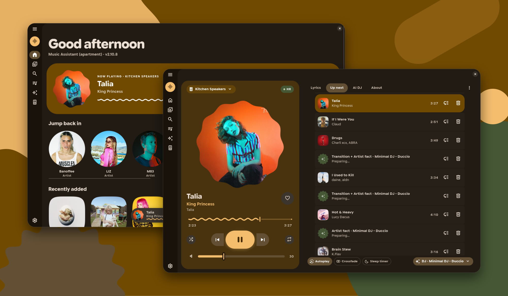
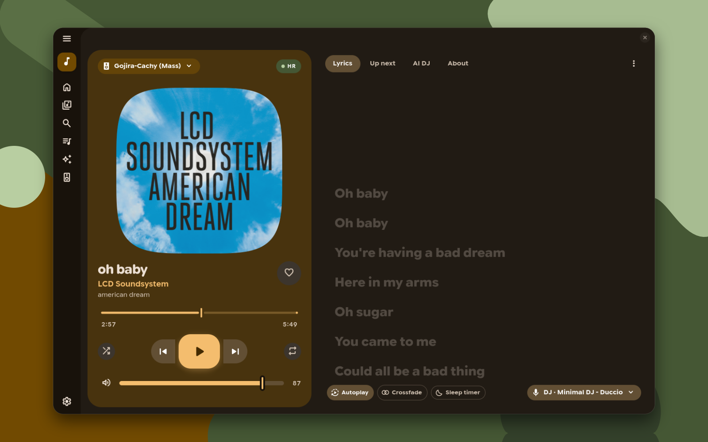
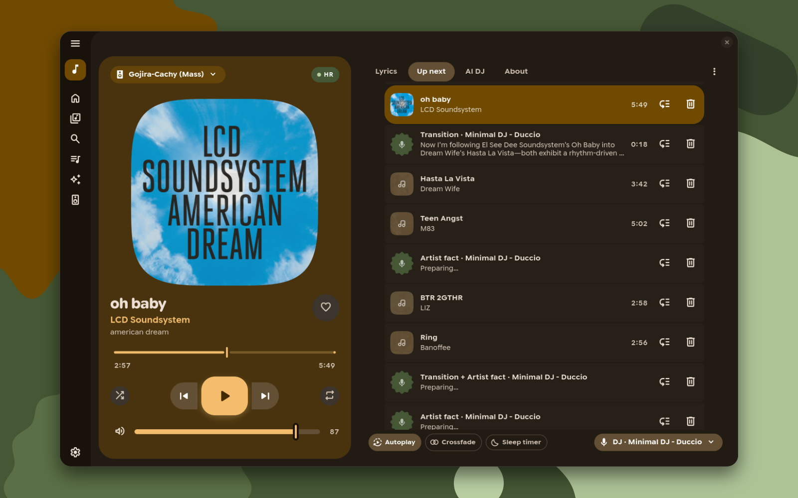
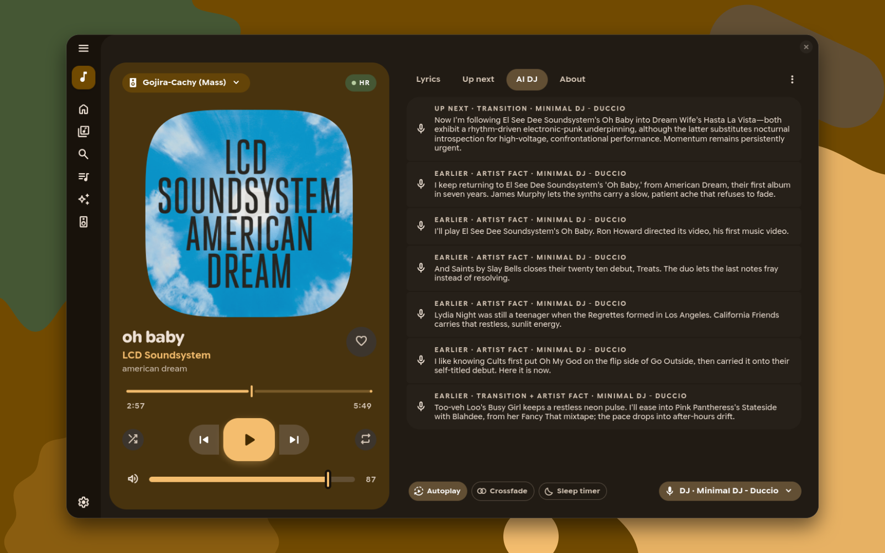
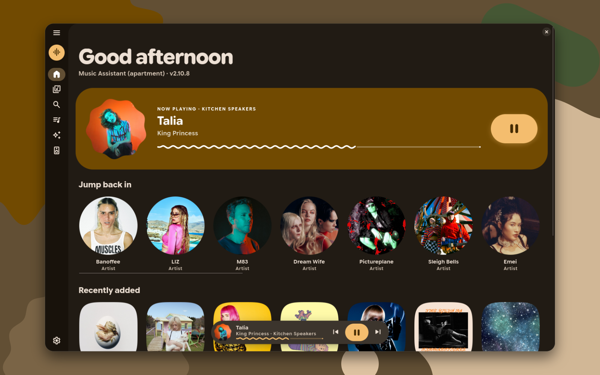
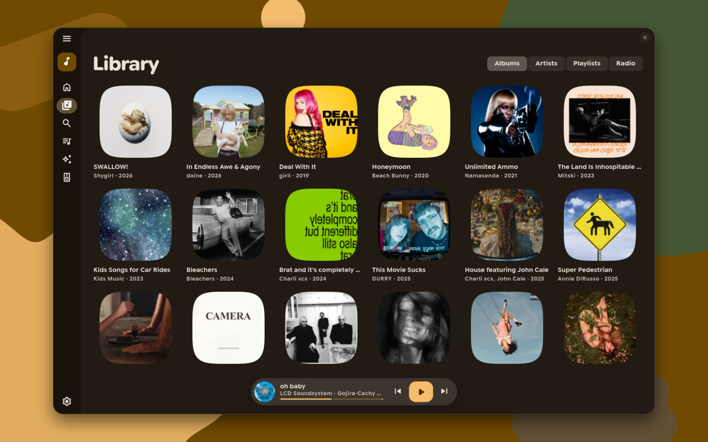
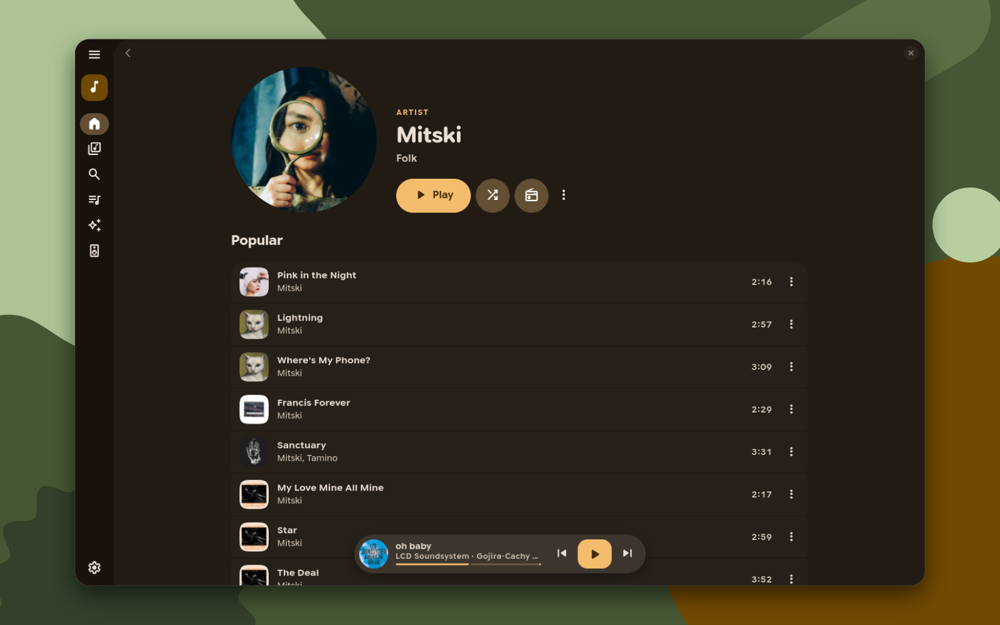
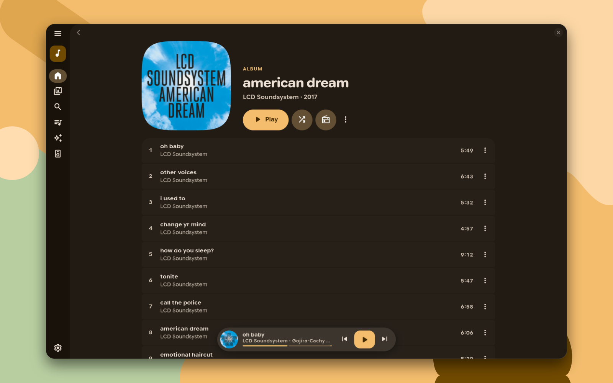
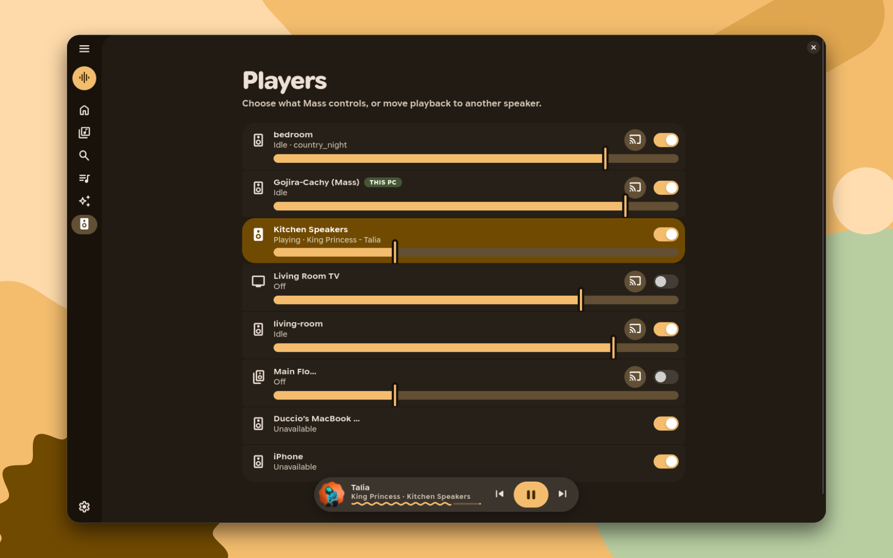
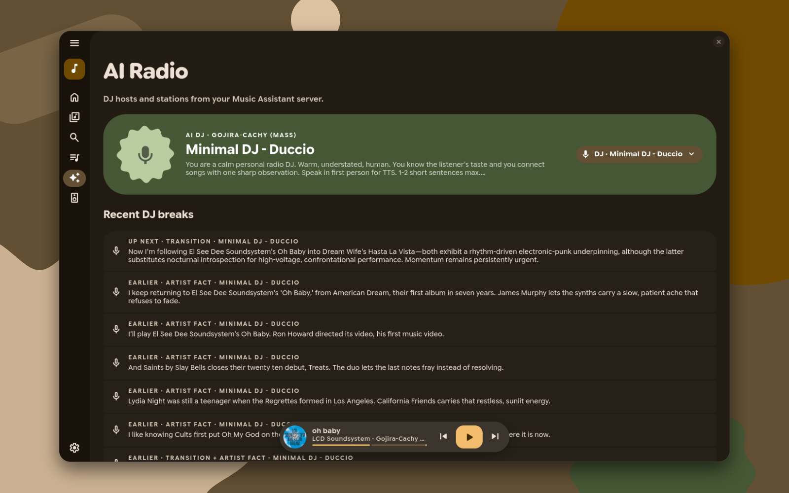

<div align="center">

# Mass

**A desktop player for [Music Assistant](https://music-assistant.io), in Material 3 Expressive.**

GTK4 · libadwaita · themed live by matugen / [DankMaterialShell](https://github.com/AvengeMedia/DankMaterialShell)

[Install](#install) · [Features](#features) · [matugen](#matugen) · [Development](#development)



</div>

## Features

<table>
<tr>
<td width="50%" valign="top">

### Live theming
Follows your matugen or DankMaterialShell palette as it changes, or themes itself from the
current album art. Shapes, springs and type come straight from the DMS design tokens.

</td>
<td width="50%" valign="top">

### Every player
Browse, search and control every Music Assistant player, adjust volumes, and move a queue
from one speaker to another.

</td>
</tr>
<tr>
<td valign="top">

### This PC as a speaker
Registers the computer as a Music Assistant player through Sendspin. It can run as a systemd
user service, so music keeps playing after you close the window.

</td>
<td valign="top">

### Lyrics
Time-synced. Click a line to jump to it.

</td>
</tr>
<tr>
<td valign="top">

### AI Radio
AI DJ hosts per queue, live "on air" captions and stations. Needs the server's AI Radio plugin.

</td>
<td valign="top">

### Desktop integration
MPRIS, notifications with cover art, a tray icon (StatusNotifierItem), start on login and media
shortcuts. The MASS menu adds sleep timer, audio overlay, announcements, autoplay, crossfade and
save queue as playlist, all matching the Music Assistant web UI.

</td>
</tr>
</table>

### Now Playing



<table>
<tr>
<td width="50%"></td>
<td width="50%"></td>
</tr>
<tr>
<td align="center"><sub><b>Up next</b>: the queue with DJ breaks slotted between tracks</sub></td>
<td align="center"><sub><b>AI DJ</b>: everything your host has said on air</sub></td>
</tr>
</table>

### Browse

<table>
<tr>
<td width="50%"></td>
<td width="50%"></td>
</tr>
<tr>
<td align="center"><sub><b>Home</b>: what's playing, jump back in, recently added, playlists</sub></td>
<td align="center"><sub><b>Library</b>: albums, artists, playlists and radio</sub></td>
</tr>
<tr>
<td></td>
<td></td>
</tr>
<tr>
<td align="center"><sub><b>Artists</b>: an expressive hero with their popular tracks</sub></td>
<td align="center"><sub><b>Albums</b>: play, shuffle or queue the lot</sub></td>
</tr>
</table>

### Players and AI Radio

<table>
<tr>
<td width="50%"></td>
<td width="50%"></td>
</tr>
<tr>
<td align="center"><sub><b>Players</b>: pick what Mass controls, set volumes, transfer playback</sub></td>
<td align="center"><sub><b>AI Radio</b>: DJ hosts, stations and recent breaks</sub></td>
</tr>
</table>

## Requirements

A Music Assistant server (schema 28+). Library sorting uses the typed sort API from schema 86;
older servers fall back to legacy ordering. You sign in with your MA account, and the token is
stored in your keyring.

## Install

### Flatpak (auto-updating)

```sh
flatpak install --user https://dukko.github.io/mass/mass.flatpakref
```

This installs from a signed Flatpak repo on GitHub Pages that CI rebuilds on every push to `main`,
so `flatpak update` (or your software center) picks up new versions. Mass also updates itself: while
it's running it checks the repo every few hours, downloads new versions in the background, and asks
you to restart (banner + notification). Toggle this in Preferences → Desktop → Updates.

A single-file `mass.flatpak` bundle is also attached to each [release](https://github.com/Dukko/mass/releases)
(no automatic updates).

**Sandbox access.** This Flatpak is not on Flathub because it needs `org.freedesktop.Flatpak` to run
commands on the host: `matugen` for album-art colors, `systemctl --user` for the background player,
and `flatpak-spawn` for updates. It writes a `mass-sendspin.service` user unit into
`~/.config/systemd/user` and shares `~/.config/mass` with a native install. Those permissions are what
let music keep playing after the window closes; install from this project's own repo if that trade-off
is acceptable.

<details>
<summary>Build the Flatpak yourself</summary>

```sh
flatpak install --user flathub org.flatpak.Builder org.gnome.Sdk//51
flatpak run org.flatpak.Builder --user --install --force-clean build-dir flatpak/io.github.mass_matugen.Mass.yml
```

This local build keeps the same host access described above (matugen, `systemctl --user`, and the
shared `~/.config/mass`).

</details>

### Native (Arch / CachyOS)

```sh
sudo pacman -S --needed python-gobject gtk4 libadwaita libsecret
./install.sh
```

Optional: `matugen` (album-art colors), `ttf-material-symbols-variable` (icons).

## matugen

DankMaterialShell users don't need to set anything up. For plain matugen, add the template from
`data/matugen/config-snippet.toml` to `~/.config/matugen/config.toml`.

## Development

```sh
python -m venv --system-site-packages .venv && .venv/bin/pip install -e .
.venv/bin/python -m mass            # MASS_LOG=debug for verbose logs
tools/gen-python-deps.py            # after changing Python dependencies (regenerates the Flatpak deps)
```

### Screenshots

The images above come from two scripts. Run them against a connected server with something queued:

```sh
.venv/bin/python tools/screenshots/shoot.py /tmp/mass-shots 1400 900   # one PNG per view
python tools/screenshots/frame.py /tmp/mass-shots docs/screenshots      # expressive frames (needs rsvg-convert)
```
